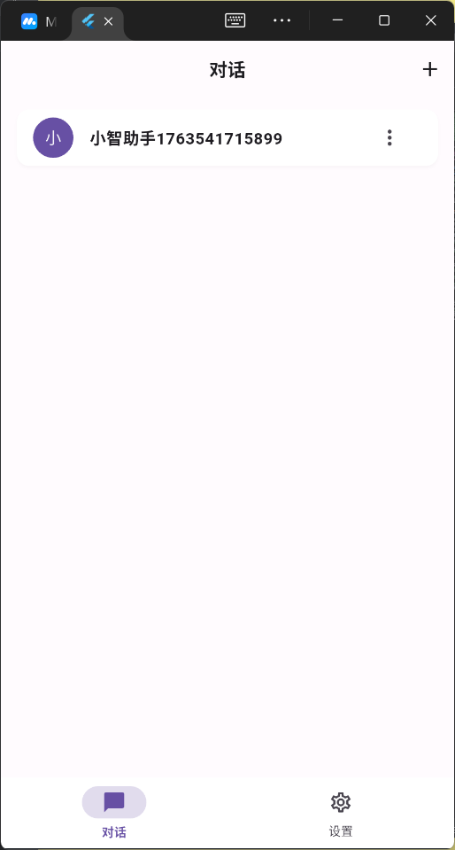
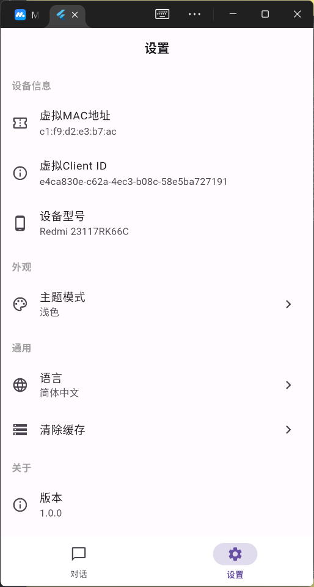
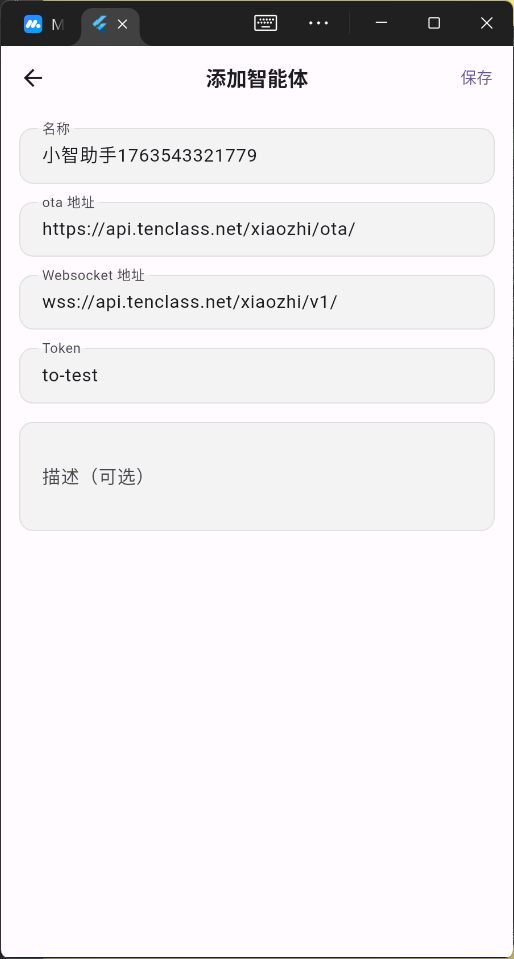
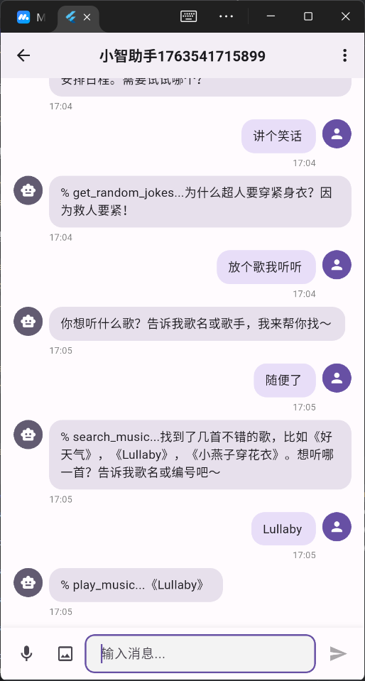
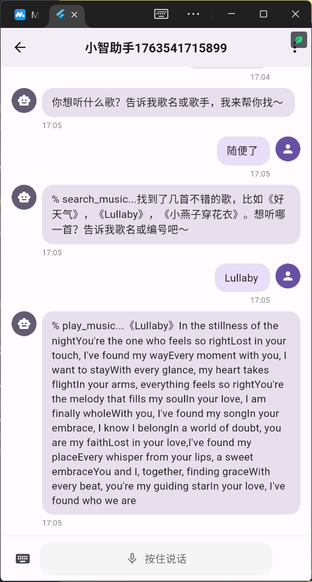

# 小乐 (XiaoLe) — 小智客户端微信风定制版

<p align="center">
  
  
  
</p>

本仓库是小智客户端 Flutter 版（上游 [eiriksgata/xiaozhi-client-flutter](https://github.com/eiriksgata/xiaozhi-client-flutter)）的**微信风 UI 定制版**，由张老师定制维护。上游的架构与功能说明保留在本文档后半部分，仍然适用。

## ⚠️⚠️ 头号铁律：虚拟 MAC 必须【全小写】（2026-09-07 实测）

**症状**：设备 OTA 激活**一切正常**（验证码、绑定、控制台显示在线、WS 地址正常返回），但连上后 **30~150 毫秒被服务器无状态码静默踢线（close code = 1005）**，与"未激活 / 身份错误"现象完全一样，日志中看不出任何区别。

**根因**：小智服务器的 **WebSocket 按 `device-id` 查设备，区分大小写**；而 **OTA 查库不区分大小写**，所以大写 MAC 能激活成功，却连不上。

**执行要求（三处统一小写）**：

| 位置 | 要求 |
|---|---|
| 随机 MAC 生成 | 生成小写（`toRadixString(16)` 天然小写，**严禁 `.toUpperCase()`**）— v1.1.7 已修 `agent_config_page._randomMac()` |
| 手动编辑 MAC | 设置页保存时强制 `toLowerCase()` 兜底 — v1.1.7 已加 |
| 上报身份 | OTA 的 `mac_address` / `board.mac` / `Device-Id` 头 + WS 的 `device-id` |

**补救**：已用大写 MAC 建过的智能体**不需要重新激活**，到「设置 → 设备信息 → 编辑虚拟MAC地址」把 MAC **改成小写**保存，重进对话即可。

**顺带**：OTA 返回的 `websocket.token` 是字面量 `test-token`，属服务器正常下发，不是异常。

## 🎉 v4.0.0 正式发布（2026-09-09）——3.x 实践期收官

基于《xiaoleweb.md》（**协议技术全景，见同一工作区兄弟目录** `xiaole-web-2027/xiaoleweb.md`）技术全景对 App 的系统性优化全部落成（v3.0.0→v3.3.0 四个实践版本）：

| 能力域 | 内容 |
|---|---|
| 🔌 MCP 设备端 | 与真机 m5stack-core-s3 完全对齐的 **11 项工具**：音量/主题真实操控、AI 主动拍照识图、定时器/日程（到点震动提醒）、AI 屏显图片、设备状态（含桌面端真实电量的网页版同款设计） |
| 📡 MQTT 常驻在线 | 原生 TLS 8883 直连 broker（keepalive 240s）——后台显示在线 + 远程主题/音色配置解锁 |
| 📷 视觉识物 | 手动 📷 与 AI take_photo 双入口，multipart 直传 vision 接口 |
| 🎤 通话体验 | realtime 持续监听 + barge-in 抢话打断（能量检测 400ms 判据）+ 挂断 abort |
| 🔧 通信正确性 | tts stop/end 双兼容、指数退避重连（12 次上限 + close code 分类）、想打就打自动连接、listen mode 防交叉、身份拟真对齐 m5stack-core-s3 |
| 🛠️ 工程体系 | 三级红线制、AppFeats 开发者开关（默认灰度 MQTT）、CI 自动打包发 Release、回滚锚点 `stable-1.1.7` |

## 📚 文档索引与状态标记（**后来的 AI 请先读这一节**）

> 本项目文档较多，**每一份都有明确状态**，避免把「历史档案」误当成「待办需求」——这是本仓库最常见的噪音来源。

| 文档 | 角色 | 状态 |
|---|---|---|
| **`进度与续接.md`** | ⭐ **唯一进度真相**：当前基线版本 / 每版状态表 / 回退锚点 / 断电续接步骤 | 🟢 **活跃维护（每版必更）** |
| **`README.md`**（本文） | 版本档案（含 **CI 状态**）/ 回退指南 / 改动红线 / 文档索引 | 🟢 **活跃维护（每版必更）** |
| **`CHANGELOG.md`** | 每个版本做了什么（按版本倒序，含事故复盘） | 🟢 **活跃维护（每版必更）** |
| `PLAN_v6.1.x` ~ `PLAN_v6.8.x`、`PLAN_v4.x` 等 | 各版本的**需求与验收标准**档案（含踩坑依据） | 🔵 **已冻结**（头部均标「✅ 已实施」，勿当待办） |
| `docs/plans/archive/` | **废弃方案稿**（已被定稿取代） | ⚪ **归档**（头部标「⛔ 已废弃」，**勿据此施工**） |
| `xiaoleweb.md` | 小智协议技术全景 | 📦 **不在本仓库** → 在**同一工作区的兄弟目录** `xiaole-web-2027/xiaoleweb.md`；其 GitHub 仓库为 **`openclawzhangchong/xiaole-web2027`（⚠️ 无连字符；带连字符的 `xiaole-web-2027` 是空仓库，勿推错）** |
| `小智websocket协议.md`、`小智硬件 Android 迁移指南.md` | 协议 / 硬件参考 | 🟡 参考文档（变动少） |
| `APP优化方案.md`、`视觉方案修复.md`、`故障报告_*.md`、`AUDIT_*.md` | 历次诊断与优化依据 | 🔵 历史存档 |

### ⚠️ 新版本发布后**必须**同步的标记（否则会给后来的 AI 造成噪音）

1. **本文件「版本档案」**：加新版本一行，并在**拿到 CI 结论后立即回填「验证状态」列**
   —— `✅ CI 通过（run xxx）` / `❌ 构建失败、无 APK、勿用`。
   **严禁用「待验证 / 已实现待发布」长期挂账**：历史上一批版本曾长期留着旧模板文案，导致
   `v6.8.1`（实际构建失败）被标成 `✅ CI 通过`，差点误导回退选择。
2. **`CHANGELOG.md`** 加 `## v<版本>` 段；**`进度与续接.md`** 更新基版本 + 状态表 + 回退锚点表。
3. **版本号两处必须一致**：`pubspec.yaml` 的 `version:` 与 `lib/app/config/app_config.dart` 的 `appVersion`。
4. **方案文档**：已完成的在头部标「✅ 已实施 + 对应发布版本」；**被取代的废弃稿移入
   `docs/plans/archive/` 并加「⛔ 已废弃」横幅**。

> **达标口径**：任何一份文档，读它的人（人或 AI）**不需要猜测它的状态、也不需要去别处对照**。

## 📌 版本档案（已知可用版本）

> 每个发布版本**在 CI 出结论后**立即登记，并**回填「验证状态」列**（不挂「待验证」）。
> **改动出错需要回退时，优先按下表找最近的 ✅ 版本**；标 ❌ 者为**构建失败、无 APK**，**勿用**。

| 版本标签 | 内容 | 包名 | 验证状态 | 验证日期 |
| `v6.11.0` | 🎨 **开发者中心排版重排贴微信原型** —— 起因：张老师反馈 v6.10.0「开发者中心排版无变化」。**诊断确认根因**：v6.10.0 是控件替换、布局骨架未动（分组容器仍是 iOS 圆角浮动卡风），与微信原型**通栏直角风**（radius 0、无边距、组间 10px 灰隙）不一致。本版（方案 **V1**，用户批准）：① `_section` 重写为**通栏直角白卡**（去左右 margin、radius 0、组间 10px 灰隙，0.5px 分割线由 WxCell 自带）；② 全页 **emoji 下岗** → 28px 彩色圆角图标块（`_iconTile`，语义色走 AppColors：MCP=info 蓝、外部 MCP=primary 绿、视觉=cloudBlue、主动联系=amber、调试=gray…）；③ 入口行加**右侧灰色值**（WxCell `trailingText`）：巡检间隔「每 N 分钟」/ 电话日志「最近 50 轮」/ MCP 工具「26 项」；④ 顶部「N 项开启」**移到页面底部版本脚注**（对齐原型 `.profile-version`）。⚠️ 分组灰标题**保留**（dev center 功能多、无标题难扫读，与原型差异点已向用户说明）。**仅改 `dev_center_page.dart`（+ 色板 token），行为零改动**；`_McpToolsDetailPage` 的同名 `_section` 重载未动。版本号 `6.10.0+51` → `6.11.0+52`。自检：见 CHANGELOG.md 验证列（占位，CI 结论稍后回填）。详见 CHANGELOG.md | `com.zcstudy.xiaole` | ✅ CI 通过（run **35334496762**，attempt 1 success；APK 40,773,270 B sha1 `84fc6c2a` 已下载桌面 `xiaole-client-v6.11.0.apk`） | 2026-09-18 |

| `v6.10.0` | 🎨 **微信风收口与 Design Token 治理** —— 起因：张老师提议引入 `tdesign_flutter` 让 UI 更贴微信。**评估后否决** —— 兼容性实测没问题（仓库外探针跑 `pub get` **179 包零冲突**，其 pubspec 零第三方依赖），但 **TDesign 默认主色蓝 `#0052D9` + 12px 圆角卡片 + 阴影**，与微信「绿 / 扁平无阴影 / 0.5px 细线」是对立美学；且官方 **51 个组件中聊天/气泡/IM 类 = 0**（`Message` 是全局 Toast、`Popover` 是 tooltip）⇒ 净收益三项全负（更不像微信 + APK 增大 + golden 全失效）。**评估过程挖出真病根**：`AppTextStyles` 与 `AppDimens` **全项目零引用（死代码）** —— 根因是旧版把 `color` **写死在 TextStyle 里** ⇒ 深色模式不可用 ⇒ 没人敢用 ⇒ 全项目改用硬编码字号，累计 **124 处 / 15 种取值**（13 与 14、15/16/17 成对冲突）。⚠️ **教训：「文件存在」≠「token 在用」，判断设计系统健康度必须统计真实引用数。** 本版：① **重写 `app_text_styles.dart`**（5 档阶梯 **11/12/14/17/20**，**不含颜色**，改用 `primaryText(context)` 等 6 个辅助方法按 light/dark 取值）；② **新建 `app_dimens.dart`**（原同名类从 app_colors 迁出，避免 import 冲突）；③ **新建 6 个微信风组件** `WxCell / WxCellGroup / WxDialog / WxActionSheet / WxIconButton / WxEmpty`；④ **字号 124 处全量收敛**（映射 13→12、15→14、**16→17**、18→17；≥22 与 `size*` 计算值刻意保留）—— **聊天气泡 16→17 对齐微信正文**是最大收益；⑤ 会话列表长按菜单 → **微信屏幕正中央深色 ActionSheet**；⑥ 设置页 8 个 `ListTile` → `WxCell` 并**补齐行间 0.5px 细线**（原实现行间无线）、主题弹窗 → 微信选择菜单（带对勾）、**音量 Slider 保留本体仅改微信绿**；⑦ **10 个页面 Material 控件清零**（残留仅 `activation_dialog` 的 AlertDialog 外壳 —— 含验证码+倒计时+提交回调，复杂有状态，只换视觉外壳风险最低）。**新增 8 文件 / 修改 31 文件**。自检：analyze **0 error / 0 warning**、全量测试 **71/71**、5 张 golden 重生成并**逐张目视核对**。🔒 未碰 `app_theme.dart`（全局引用，改它会连带影响 chat_page 与全部 golden）/ `lib/core/network` / `lib/data` / 冻结区；**纯视觉层，无行为变更**。⚠️ 已知取舍（未改，留待决策）：**圆角只收敛野生值**（10→8、14→12），5/6/7/8 保留 —— 1px 差异无视觉收益，且 `7` 是 28px 图标色块的微信**正确**值、`6` 是 48px 会话头像的正确值；**54 处硬编码点缀色仍在**（属设计决策，需新增语义色 token）。详见 CHANGELOG.md | `com.zcstudy.xiaole` | ✅ CI 通过（run **35306362258**；首次 attempt 因 runner SIGTERM 中断，重跑成功；APK 40,772,570 B 已下载桌面 `xiaole-client-v6.10.0.apk`） | 2026-09-18 |

| `v6.9.1` | 🔴 **修复「小智 AI 识别不到外部 MCP」（真实回归）** —— 症状：v6.4.4 时 biji-notes 与高德地图的工具 AI 都能识别，**v6.8.1 起全部识别不到**。根因：`AppFeats.mcpToolEnabled()` **同时服务设备工具与外部 MCP 工具**（`chat_page` 只注入一个 `isToolEnabled`），而 v6.8.1（E 项）把默认值统一改成「只放行 5 项设备工具白名单」，外部工具名（`notes.*` / `amap.*`）不在白名单 ⇒ 被判禁用 ⇒ `tools/list` 不再下发 ⇒ AI 完全看不到。修复：`mcpToolEnabled()` 末尾**按来源分别判定**——**非 `self.` 前缀（外部 MCP 工具）默认放行**，`self.*` 仍走白名单（E 项本意保留）。**新增 6 例回归测试**（含"已存值优先于默认值"），全量测试 **71/71**。⚠️ 顺带澄清：「外部 MCP → 逐工具开关」页自 v6.4.0 就存在，缺陷期间因被整层杀掉而"看起来没效果"，修复后已**真正生效**。版本号 `6.9.0+49` → `6.9.1+50`。详见 CHANGELOG.md | `com.zcstudy.xiaole` | ✅ CI 通过（run 35294530211） | 2026-09-18 |

| `v6.9.0` | 🎛️ **外部 MCP 工具不再「爆掉」：逐工具开关看得见、好用** —— ① 服务器列表直接显示「**已启用 N/M 个工具**」（原来只看得到总数，看不出有几个被关、也看不出能逐工具管理）；② 工具页右上角 ⋮ 新增「**全部关闭 / 全部开启**」批量操作（直击「20 个只要 1 个却要手动关 19 次」的痛点，改为先全关再挑要的）；③ 顶部加「已启用 X / 共 Y 个；关闭的工具不会下发给 AI」说明。⚠️ **说明：逐工具开关能力在 v6.4.0 就已存在**（数据层 `disabledTools` + `mergedTools()` 过滤 + `dispatch()` 拦截 + 逐工具开关页），本次**不是从零实现**，只补「看不见、不好用」的缺口。**改动仅 1 个文件** `external_mcp_page.dart`，数据层 / 管理器 / 协议层**一律未动**，默认策略仍为全开（仅破坏性工具 `merge_notes` 默认关）。⚠️ 已知边界：黑名单语义下，服务器侧新增工具会默认启用，需再手动关一次。版本号 `6.8.3+48` → `6.9.0+49`。自检：analyze 0 error、全量测试 65/65。详见 CHANGELOG.md | `com.zcstudy.xiaole` | ✅ CI 通过（run 35283801890） | 2026-09-18 |

| `v6.8.3` | ✨ **本版本新增：AI 主动来电「电话日志」跟踪 + 智能体头像升级（第二版-下 A/C 两项收官）** —— **① A 项 MCP 电话日志**：新增**旁路记录层** `proactive_round_log.dart`（**不改动巡检任何行为**），把**每一轮**巡检结构化留痕 —— 含**被守卫跳过的轮次及其具体原因**（时段外 / 冷却中 / 语音通话中 / 上一轮未结束 / 服务未初始化 / WS 地址为空）、本轮实际发出的**口令**（detect + 12s 重发）、**是否被调用 get_script**、**是否收到 trigger_call/skip**、**开场白原文**、**本轮耗时**、**close code**、**服务器 alert**；**最近 50 轮环形缓冲** + **持久化**（App 重启仍在）；新增开发者中心「AI 主动联系」→「📞 电话日志」页，支持**一键复制全部**（纯文本，整段可贴给 AI 诊断）与清空。**② C 项 头像升级**：头像由「固定底色 + 固定符号」升级为**文字头像**（取智能体名字**第 N 字**，默认第 1 字，可选 2/3/末字/自填一字）+ **12 套预设高对比色板**（深底白字 / 浅底深灰字，**不做任意取色器**，保证任何底色下文字清晰）+ **本地图片头像**（优先级 图片 > 文字，可一键清除回落）；**全部仅存本地**（SharedPreferences + App 私有目录，**绝不写入 AgentModel、绝不碰 cloud_sync_service**）⇒ **重装 App 自动回落文字头像、换设备恢复云端数据不会带过去**；会话列表 / 聊天页 / 来电页 / 通话页**全场景统一**（同一组件），编辑入口在智能体配置页；**「我」页用户头像本次不动**。自检：analyze 0 error、全量测试 65/65（golden `audit_chat_messages` / `audit_conversation_list` 已按预期更新并经**目视核对**——isolated diff 仅落在 3 个头像方块内，无布局位移）；lead 复核另修复 2 个"保存过的头像配置不生效"的真 bug（`read()` 曾用默认值覆盖已存值 / `_lazyLoad()` 曾在 build 期间同步 notify），已补 10 例回归单测守住；另将色板对比度断言从"亮度代理"升级为**真算 WCAG 对比度**（渐变两端均 ≥ 4.5:1，已用负向对照实测其有效性——故意调浅底色会立即报错 `2.26:1`，12 套色板实测最差 4.63:1）。版本号 `6.8.2+47` → `6.8.3+48`，`appVersion` → `6.8.3`。⚠️ 发布插曲：本 tag 首次 CI 尝试在 **APK 构建成功之后**的上传 Release 资产环节因 `socket hang up`（上游网络瞬时抖动）失败，**重跑后全绿**——非代码问题，详见 CHANGELOG「⑥ 发布与 CI」。⚠️ 已知边界（未改，留待决策）：`AndroidManifest` 未声明 `allowBackup`（默认 `true`），系统级备份可能把头像图片带回来，见 CHANGELOG「⑦」。详见 CHANGELOG.md | `com.zcstudy.xiaole` | ✅ CI 通过（run 35256912342，第 2 次尝试 success） | 2026-09-18 |
| `v6.8.2` | 🔧 **真正修复 Android 构建（补 core library desugaring）+ 聊天页进入即显示最新** —— ① v6.8.1 修对了 workmanager 但仍构建失败：CI 在 `:app:checkReleaseAarMetadata` 报 `Dependency ':flutter_local_notifications' requires core library desugaring to be enabled`；本版在 `android/app/build.gradle.kts` 开启 `isCoreLibraryDesugaringEnabled` 并加 `coreLibraryDesugaring("com.android.tools:desugar_jdk_libs:2.1.4")`。② 聊天页消息列表改**倒置**（`reverse: true`），进入即在**最新**消息处，不再依赖"延迟滚动"时序；`_scrollToBottom` 目标改为 offset 0。自检：analyze 0 error、全量测试 51/51。⚠️ 已知取舍：消息少于屏幕时内容贴底（微信为贴顶）。详见 CHANGELOG.md | `com.zcstudy.xiaole` | ✅ CI 通过（run 35245226751） | 2026-09-18 |

| `v6.8.1` | 🔧 **修复 v6.8.0 的 Android 构建失败（后台化真正可用）+ 修「挂断后仍在说话」+ 调整默认开关** —— ① **构建修复**：`workmanager ^0.5.2` 被 Dart 的 0.x caret 语义钉死在 2023 年旧版，其 Kotlin 与 Flutter 3.32 嵌入层不兼容 → `compileReleaseKotlin` 失败（v6.8.0 因此没产出 APK）。逐个实测排除（0.10.x 需 Flutter≥3.38、0.9.x 的 apple 与 platform_interface 签名不匹配）后，**锁定 `workmanager: 0.8.0`**（要求 Flutter≥3.32 且版本组合一致）+ API 适配 `ExistingWorkPolicy.replace`。② **挂断修复**：挂断即 `AudioUtil.stopPlaying()` 静音 + `abort` 去掉门控改为无条件发送 + 挂断后**5 秒静默窗口**丢弃迟到音频帧（文字聊天共用同一音频路径，故不用全局守卫，只做窗口丢弃；发消息/新通话/接听来电会立即解除窗口）。③ **默认值**：27 项 MCP 工具仅默认开 5 项（定位/闹钟/导航/亮度/音量），📷 相机按钮默认关；**仅对新装用户生效**。自检：analyze 0 error、全量测试 51/51。详见 CHANGELOG.md | `com.zcstudy.xiaole` | ❌ **构建失败、无 APK、勿用**（run 35243265913） | 2026-09-17 |
| `v6.8.0` | ✨ **本版本新增：AI 主动来电「后台化」** —— 让已做好的主动来电在用户退出 App / 锁屏后也能巡检并触发来电。采用 WorkManager 周期唤醒（无常驻通知/前台服务，最省电抗杀）：系统按最小 15 分钟周期拉起 App 跑一轮巡检再睡；命中触发时用高优先临时通知「小乐想和你通话」呈现，点通知进入来电页；总开关关闭即取消后台任务（零唤醒、零流量）。新增①后台入口 `proactive_background.dart`（@pragma 入口 + 最小初始化 + 总开关守卫 + 前后台互斥）+ ②高优先通知渠道与展示（Android 13+ 运行时申请 POST_NOTIFICATIONS，被拒优雅降级并在开发者中心提示）+ ③后台保活引导页（电池优化白名单/自启动/后台运行限制三步，android_intent_plus 跳系统页）+ ④三守卫复用（`checkGuardReason` 前后台共用同一份实现，新增带守卫单轮入口 `runGuardedRoundForBackground`）。**V2 常驻通知+前台服务本次不做**（留待实测对比）。版本号 `6.7.1+44` → `6.8.0+45`，`appVersion` → `6.8.0`。新增依赖 `workmanager ^0.5.2`、`flutter_local_notifications ^17.2.0`。详见 CHANGELOG.md | `com.zcstudy.xiaole` | ❌ **构建失败、无 APK、勿用**（run 35238877295） | 2026-09-17 |
| `v6.7.1` | ✨ **本版本新增：用户协议/隐私政策页的「品牌名纠正 + 文案与排版完善」** —— ① 全仓 9 处用户可见 UI 文案的「小智」统一改为「小乐」（用户协议页 6 处、隐私政策页 2 处、开发者中心 AI 主动联系副标题 1 处）；底层注释/日志/协议表述（小智服务器/硬件/协议等 22 处）一律不动。② 用户协议页新增「产品定位」段落（小乐适合哪两类人 + 7 条能力，含多设备协作端、存网盘/发微信等规划能力，按张老师要求原样写入）。③ 隐私政策「权限清单」改为上下堆叠自适应布局（权限名在上、用途/后果在下，任意屏宽自动换行、不溢出、不截断，深浅色均正常）。版本号 `6.7.0+43` → `6.7.1+44`，`appVersion` → `6.7.1`。详见 CHANGELOG.md | `com.zcstudy.xiaole` | ✅ CI 通过（**最新可用回退点**，有 APK） | 2026-09-17 |
| `v6.7.0` | 🎨 **「我」页与开发者中心分层重构（V2 方案）** —— 「我」页纯普通用户化：资料头 → 账号与云（提顶）→ 通用（主题+音量合并）→ 关于 → 开发者，**设备身份编辑全部迁出**；开发者中心重排 6 组：①设备身份（MAC/ClientID/型号迁入，⚠️ MAC 强制小写语义不变）②AI 能力（原「能力开关」拆分）③AI 主动联系 ④连接与音频（MQTT/AEC 单点/尾音保护）⑤调试（+音频能力检测迁入）⑥管理（清除授权+全部关闭合并）。AEC 收敛为单点消除双重控制。新增「用户协议」（功能介绍 10 大能力，只讲能力不讲机制不暴露上游）与「隐私政策」（权限引导 + 电池优化/自启动保活指引）两个真实内容页（原为 TODO 空壳）；`_editDeviceField` 抽公共组件 `device_edit_dialog.dart`。me 页 golden 基线已重生成（仅 `audit_profile_page.png` 变化），全量测试 37/37 通过。版本号变更说明：AI 主动来电后台化原预留 v6.6.0，为避免撞号本版改号 v6.7.0，后台化仍归 v6.6.0。详见 CHANGELOG.md 与 `PLAN_v6.7.0_我的页与开发者中心重构.md` | `com.zcstudy.xiaole` | ✅ CI 通过 | 2026-09-17 |
| `v6.5.0` | 🤖 **AI 主动来电（方案 D：口令存本地 + 设备 MCP 工具取回）** —— 前台定时巡检：小智调 `self.proactive.get_script` 取回**本地口令**→自主判断→命中则调 `trigger_call` 弹**全屏模拟来电**（450Hz 回铃音+震动+30s 倒计时）→接听后小智调 `get_opening` **先开口说开场白**→进入双向对话。关键实测结论驱动设计：**detect 只有 16 字**（长指令走工具返回值）、**服务器按 Device-Id 记住执行过**（故**多条口令轮换**，实测轮换 5/6 vs 固定 0/6）、**同设备并发双 WSS 必须用不同 Client-Id**（否则旧连接 1005 被踢）、**biji 笔记只能新建不能删**（故本方案**完全不写笔记**）。新增口令管理页（增删改查/恢复默认/≤16字）+ 开发者中心「AI 主动联系」区块（总开关/间隔/来电时段）；零新增依赖。回滚锚点 `anchor-pre-v6.5.0`。详见 CHANGELOG.md | `com.zcstudy.xiaole` | ✅ CI 通过 | 2026-09-17 |
| `v6.4.4` | 👥 **服务器 alert 按开发者/普通用户身份分流** —— 承接 v6.4.3 的 alert 处理，但当时**不管是谁都显示技术原文**（如 `Detect is only for wake words, do not send long texts.`），普通用户看不懂。改进：新增开发者中心开关「⚠️ 显示服务端原始提示」（`AppFeats.rawServerAlert`，**默认关 = 普通用户模式**）——开启=开发者模式，聊天页直接显示服务器 alert 原文（保持 v6.4.3 行为）；关闭=普通用户模式，改用友好气泡 +「发送失败」弹窗（如「这条消息有点长，没能发出去～把内容缩短一些再发一次吧。」）。该开关**列入 `keys`**，故「全部关闭」(`allOff()`) 会一并关掉，一键回到普通用户模式。改动范围：`app_feats.dart` + `dev_center_page.dart` + `chat_page.dart`（新增 `_friendlyAlertText`/`_showFriendlyAlertDialog` 两个辅助方法），不改发送逻辑、不加客户端长度限制、不引入新依赖。详见 CHANGELOG.md | `com.zcstudy.xiaole` | ✅ CI 通过 | 2026-09-17 |
| `v6.4.3` | 🔔 **修「服务器 alert 未被处理」** —— App 所有文字都走 `listen/detect` 通道，官方服务器对 detect 文本有硬上限（实测 16 字通过/18 字被拒），超限回 `type:alert` 报错；但客户端**此前完全没有处理 alert**（落到 switch 的 default 只记日志），导致**长句被服务器静默拒绝、界面上毫无提示**（用户以为发出去了）。修复：`_handleTextMessage` 新增 `case 'alert':` → 记日志 + 追加「⚠️ 服务端提示」系统气泡 + ERROR 时弹提示条。仅 1 文件、不改发送逻辑。详见 CHANGELOG.md | `com.zcstudy.xiaole` | ✅ CI 通过 | 2026-09-17 |
| `v6.4.2` | 🐞 **修历史遗留 Bug：一键云端恢复后智能体列表不刷新** —— 恢复（pull）后智能体不会立刻出现在首页/聊天列表、要手动新增一个才"顺便"显示。根因：`applyPullResult` 直接写 SharedPreferences 但**未通知** `agentListProvider`（内存列表仍是旧缓存），且 `CloudSyncPage` 原是普通 `StatefulWidget` 拿不到 `ref`；`agentListProvider` 又非 autoDispose，重进页面也不重读磁盘。修复（最小改动，1 文件）：`CloudSyncPage` → `ConsumerStatefulWidget`，恢复后 `await ref.read(agentListProvider.notifier).loadAgents();`（与新增路径的刷新动作等价）。详见 CHANGELOG.md | `com.zcstudy.xiaole` | ✅ CI 通过 | 2026-09-17 |
| `v6.4.1` | 🎁 **内置预置「笔记 + 高德」两台外部 MCP**：首次启动自动写入预置配置，开箱即用不必手导入；用户可进编辑页改 `headers`（笔记 token）或 `url` 里的 `key=`（高德）换成自己的，**不改就走默认**；删除后不会自动塞回，可用管理页「恢复预置（笔记/高德）」或空列表的「载入预置」按钮重载（按 id 去重）。破坏性工具 `merge_notes` 默认关闭。⚠️ 预置 token/key 会打进 APK（可被提取），建议为高德 key 配白名单与配额。详见 CHANGELOG.md | `com.zcstudy.xiaole` | ✅ CI 通过 | 2026-09-17 |
| `v6.4.0` | 🌐 **外部 MCP 接入（App 内增删改 + 加前缀桥接给 AI）**：开发者中心新增「🌐 外部 MCP」入口——支持**多条**外部 MCP 服务器配置的增/删/改/停用，**可粘贴 `{"mcpServers":{...}}` JSON 导入**，显示每台连接状态（在线·N 工具 / 失败原因），支持**整台开关 + 逐工具开关**。桥接层：App 兼任 MCP 客户端连接外部 streamable-HTTP 服务器，外部工具按**前缀**暴露给 AI（`notes.search_notes` / `amap.maps_geo`），与设备工具合并下发，AI 调用时转发；建连时预拉取确保首轮 `tools/list` 可见。`xiaozhi_mcp_responder.dart` 纯加法（新增可选回调，为 null 时行为不变）。⚠️ 实测关键坑：**biji 有双重 UA 校验（非浏览器 UA 401/403）**、**amap 的 Accept 必须含 text/event-stream（否则 406）**、**amap 错误 key 是 HTTP 200 + body 报错（不能只看状态码）**。详见 CHANGELOG.md 与 `PLAN_v6.4.0_外部MCP接入.md` | `com.zcstudy.xiaole` | ✅ CI 通过 | 2026-09-17 |
| `v6.3.0` | 🧰 **设备 MCP 详情页（逐项开关）+ 定位能力**：① 开发者中心「📋 查看已注册的工具清单」由只读弹窗升级为**可操作详情页**——26+1 项 MCP 设备工具**逐项开关**（下行层 `tools/list` 过滤、命中禁用工具 `tools/call` 回 `-32601`；总闸 `mcptools` 关时逐项置灰，逐项设置独立于总闸、不被「全部关闭」清空）；② **新增定位能力** `self.location.get_current`（第 27 项工具）——权限检查/申请 + 定位服务开关检查 + 高精取位（8s 超时降级最近已知位置）+ **WGS-84→GCJ-02 转换**，全程异常内部消化、绝不阻塞 UI，仅 AI 调用时按需取位。依赖新增 `geolocator ^13.0.0`，AndroidManifest 加定位权限。`xiaozhi_mcp_responder.dart` 纯加法。详见 CHANGELOG.md 与 `PLAN_v6.3.0_设备MCP详情页与定位能力.md` | `com.zcstudy.xiaole` | ✅ CI 通过 | 2026-09-16 |
| `v6.2.1` | ⭐⭐ **历史版本**：**聊天页底部「连接错误」红条降噪** —— 瞬时网络错误（`SocketException` / `Failed host lookup` / `Connection refused` / `Connection timed out` / `Connection reset` 等，典型如小智服务器 `api.tenclass.net` DNS 偶发失败 `errno=7`）**不再弹红条打扰**（自动重连会自行恢复），改由**顶部状态栏**显示「网络异常，正在自动重连…」并记日志；**需用户处理的错误仍弹红条**（身份拒绝 432x / 重连超上限 / OTA 认证失败）。改动仅 `chat_page.dart` 一个文件，冻结文件未动。详见 CHANGELOG.md | `com.zcstudy.xiaole` | ✅ 已发布（历史版本） | 2026-09-13 |
| `v6.2.0` | ⭐⭐⭐ 上一版：**一键云端修复「设备身份」上传与恢复 + 新增「清空云端数据」**。① **修复 MAC/设备ID 无法恢复**（症状：重装后连不回原智能体）——根因是**上传与恢复两端都没处理身份**（上传只带 fOta/fWs/fToken，恢复只写列表/记录/昵称），现已：上传补 `conf.fMac/fCid`、恢复写回 `AgentIdentityStore`、并**把首个智能体身份设为全局**；云端零改动（`agents` 整体 JSON 透传）。② **新增「🗑 清空云端数据」**：App 端二次确认 → 云端 `POST /clear`（手机号+用户名双因子核验 → 删 `users` 行 + 名下全部 `chat_blocks`），**云端端点已部署上线并验证**。③ **新增 `CHANGELOG.md`**（按张老师要求，此后每次更新均记录）。详见 CHANGELOG.md | `com.zcstudy.xiaole` | ✅ 已发布（历史版本） | 2026-09-13 |
| `v6.1.3` | ⭐⭐ **历史版本**：开发者中心新增「📋 查看已注册的工具清单」——弹窗分组列出全部 26 项 MCP 设备工具（工具名 + 用途说明）、附「闹钟/日程/短信/拨号/分享需用户确认才生效」提示。**改动范围：仅 `dev_center_page.dart` 一个文件** | `com.zcstudy.xiaole` | ✅ CI 成功 | 2026-09-13 |
| `v6.1.2` | ⭐⭐ **历史版本**：修复截屏的 GPU 资源泄漏（`ui.Image` 未 `dispose`）—— `self.screen.snapshot` 里 `ro.toImage()` 得到的 `ui.Image` 用完**未 `dispose()`**，导致**每次截屏泄漏一张图的显存**（独立验证员发现，多次截屏可能 OOM）。修复：`try { ... } finally { img.dispose(); }`。**内容其余部分与 v6.1.1 完全一致**（MCP 设备工具 11→26 项 + 截屏已可用 + 手电筒未实施） | `com.zcstudy.xiaole` | ✅ 已发布（历史版本） | 2026-09-13 |
| `v6.1.1` | ⭐ **历史版本**：修复 v6.1.0 截屏工具失效（补 `RepaintBoundary`）——**截屏已可用，但存在显存泄漏**，已被 v6.1.2 取代。——`self.screen.snapshot` 初版漏了「给聊天页根视图包 `RepaintBoundary`」这一步，导致 `findRenderObject()` 永远拿不到 boundary、**截屏恒返回"不支持"**（**独立验证员发现的实锤缺陷**）。修复：聊天页 `build()` 根视图包 `RepaintBoundary(key: _snapshotKey)` + 执行器改从该 key 取 boundary。**内容其余部分与 v6.1.0 完全一致**（MCP 设备工具 11→26 项，详见下行）。⚠️ **手电筒未实施**：`torch_light 2.0.0` 要求 Dart SDK ^3.12（本项目 3.8.1），依赖解析失败，该项已从清单移除 | `com.zcstudy.xiaole` | ✅ 已发布（历史版本） | 2026-09-13 |
| `v6.1.0` | 🔧 **MCP 设备工具能力扩展（11 → 26 项）**：方案 `PLAN_v6.1.0_MCP设备工具能力扩展.md`。**① 修 3 个真机 bug**：`set_volume` 从「软件增益」改为**控制系统媒体音量**（根治"显示 100% 实际只有一半"）；**新增 `self.alarm.set_alarm`** —— 通过 `AlarmClock.ACTION_SET_ALARM` 调**真·系统时钟闹钟**（App 关闭/手机重启照响；原先无此工具，AI 只能拿倒计时凑数，导致"说设好了实际只设了 App 内提醒"）；`schedule.create_event` 从内存 Timer 改为**写系统日历**（根治"日程设了没用"）。**② 补齐官方标准 5 项**：`set_brightness`（应用级，免 WRITE_SETTINGS）/`get_screen_info`/`get_system_info`/`screen.snapshot`（App 内截屏，免 MediaProjection）/`reboot`（映射为"重连+清空会话"，**description 明确说明不重启手机**）。**③ 免权限系统能力 5 项**：`phone.dial`（ACTION_DIAL 只预填不直拨）/`message.send_sms`/`map.navigate`/`system.open_settings`/`system.open_url`。**④ 其他 5 项**：`show_toast`/`share.text`（分享到备忘录·笔记）/`clipboard.get`·`clipboard.set`/到点 **TTS 语音播报**（用系统自带引擎，**不下载任何模型**）。**⑤ 诚实性设计（本轮核心教训）**：所有 intent 类工具（闹钟/日历/短信/拨号）只能"发起请求"、无法确认用户是否点确认 → 返回值统一含 `requested: true` + 提示语，**从根上杜绝"AI 说设好了实际没设"的假象**。**⑥ 顺手修复 v6.0.0 遗漏**：通话全屏收起按钮未走 `_collapseVoiceCallOverlay` → 收起后系统 UI 不恢复（沉浸式残留），已补。依赖新增 5 个均锁定 Flutter 3.32.2 兼容版；**全部新能力免危险权限，AndroidManifest 零改动**；工具实现收在 `lib/core/mcp/device_capability_service.dart` + MCP 两文件内 | `com.zcstudy.xiaole` | ✅ 已发布（历史版本） | 2026-09-13 |
| `v6.0.1` | ⭐⭐ **上一个正式版**（v6.1.0 之前的交付版本）：内容与 v6.0.0 相同（CI 修复后的重打版本）；**GitHub Release「小乐 v6.0.1 ⭐ 正式版（通话全屏）」已发布并上传 APK（37MB）**；**请一律从 Release 页面下载此版本** | `com.zcstudy.xiaole` | ✅ CI 成功 + Release 已发布 | 2026-09-12 |
| `v6.0.0` | 🏆 **正式版**（版本号从 4.x 直接跳 6.0.0）。基于 **v4.4.0 原版**（含 AI 自问自答修复全套），**唯一新增功能：通话界面全屏**——通话中隐藏顶端工具栏（`appBar: _showVoiceCallOverlay ? null : AppBar(...)`）+ 系统沉浸式（`immersiveSticky`/`edgeToEdge` 进出配对），展开/收起封装为 `_expandVoiceCallOverlay()`/`_collapseVoiceCallOverlay()` 成对方法（每次展开重入沉浸式，避免状态残留），`dispose` 亦恢复系统 UI。**封存说明**：v4.5.x–v4.6.2 开发的语音扩展能力（麦克风灵敏度/端侧声纹/本地唤醒 KWS/46 唤醒词配置）**全部封存、未删除**——本地 tag `archive-voice-wip-20260912` 与远端 tag `v4.5.0`~`v4.6.2`（含 GitHub Release 的 APK）可随时找回。**本版同时完成仓库整备**：完整项目树（196→含平台目录/测试/CI，共 ~200 文件）纳入版本管理，修复重建仓库历史不完整问题；CI 工作流迁移为 `build-apk-v2.yml`（新增 `workflow_dispatch` 手动触发兜底）。**通信协议零改动；音频编解码参数零改动** | `com.zcstudy.xiaole` | ✅ 已发布（历史版本） | 2026-09-12 |
| `v4.4.0` | 🔊 **修复 AI「自问自答」（尾音被误识别成用户说话）**：定位到**三条叠加根因**——① `chat_page.dart:1577/1625-1635` 播放"结束"是**收包侧**判定（500ms 无新音频 / `tts stop`），而扬声器缓冲区最后几个字还在播，`1789-1794` 又在其后**立刻**恢复上行 → 尾音被上传；② `audio_util.dart:117` 播放侧已是 `AndroidAudioUsage.voiceCommunication`，但 `253-263` 录音侧**未配 `androidConfig`**（实际取 `AndroidAudioSource.defaultSource`）→ 两端通路不匹配，**硬件 AEC 未生效**；③ v3.2.0 引入的 barge-in 用**未消回声的原始振幅**判断（1170-1189），AI 说话必然超标误触发，提前恢复上行（根因放大器，也解释了"早几版没问题"）。修复：① **关闭 barge-in**（不再订阅振幅流、开关从开发者中心移除、代码保留可回退）；② **录音源走通话通路启用硬件 AEC**，并做成开发者中心开关「🎧 通话降噪通路（AEC）」**默认开**（可真机 A/B 对比、无需发版即可回退；**不并入 AppFeats**，避免被「全部关闭」取消）；③ **尾音保护**——AI 播放结束后丢弃麦克风音频 **默认 300ms**，开发者中心可调 **100–500ms**（实现为丢弃而非重启录音，避免爆音/丢字）；④ 日志分类**默认开启 🔊 音频**。零新增依赖（`record` 主包已 re-export `record_platform_interface`，`AndroidRecordConfig` 可直接用） | `com.zcstudy.xiaole` | ✅ 已发布（历史版本） | 2026-09-12 |
| `v4.3.5` | 🔧 **方案一落地：按官方固件做法修正 MCP 拍照路径**（依据 `视觉方案修复.md`）：读官方源码发现——`78/xiaozhi-esp32` 的 `Esp32Camera::Explain()` **全部实现只有两行**（`result = http->ReadAll(); return result;`），即把 HTTP 响应体**原样**作为 MCP 工具结果返回，由**服务端 LLM** 依据其中的 `uuid`/`message` 自行完成描述获取；**全官方仓库 `image_to_text` 出现 0 次** ⇒ **设备端不存在也不需要"第二段调用"**（`tools/call` 的方向是服务器→设备，此前反向发送必然被静默忽略）。本次修正：① `_uploadVision` 额外回传响应体原文（`raw`）；② MCP `self.camera.take_photo` 执行体**不再调 `_callImageToText`**，改为按官方做法回传响应体原文交由服务端 LLM 处理；③ 仅当响应体本身即描述（旧协议 `kind=text`）才回填 AI 气泡，新协议下不把"给 LLM 的提示"显示给用户。叠加同期文档：`视觉方案修复.md`（5 条渠道/方法）、`故障报告_识图image_to_text无响应_2026-09-11.md` | `com.zcstudy.xiaole` | ✅ 已发布（历史版本） | 2026-09-11 |
| `v4.3.4` | 🧊 **识图功能暂缓（定位为服务端问题）+ 日志分类开关收尾**：① 真机三路实验与本机 + 全网调研确认——官方服务器 `vision` 上传链路**完全正常**（HTTP 200 + `uuid`），但**对设备索要描述的所有后续动作均无可用响应**：路径 A（`tools/call image_to_text{uuid}`）**30 秒零响应**；路径 B（把服务器 `message` 当 `listen/detect` 文本发）被服务器**明确拒绝**（`alert/ERROR`：`Detect is only for wake words, do not send long texts.`）→ **本版已移除路径 B**（无效且每次触发服务端报错）；② 判定为**服务端该功能未完成**（返回的 `message` 是"给 LLM 的指令"，疑似把 LLM 提示当作 HTTP 响应返回），客户端无法通过公开协议完成 → **功能暂缓**，调用链路与埋点全部保留，`_callImageToText` 方法头**留存完整现状、证据与「日后如何继续」说明**；③ 新增仓库根文档 `故障报告_识图image_to_text无响应_2026-09-11.md`（含完整时间线、已排除项、疑点定位、请求原文，可直接转发服务器方）；④ 保留 v4.3.3 的日志分类开关（默认开 `vision`/`ws`/`mcp`）与优雅降级提示，服务器修复后可第一时间恢复 | `com.zcstudy.xiaole` | ✅ 已发布（历史版本） | 2026-09-11 |
| `v4.3.3` | 🔧 **细粒度日志开关 + 断连来源标记 + 识图多路自动尝试 + 优雅降级**（用户审批方案 V4）：① **日志分类**——`LogBuffer` 增加 category 维度，七类（vision/ws/mcp/cloud/ota/audio/ui）可在开发者中心「诊断 → 🗂 日志分类」独立开关，**默认只开 vision/ws/mcp**（识图排查链路三件套），关闭的分类**不写入缓冲**（省内存降噪音）；② **诊断增强**——`disconnect(source:)` 标注断开来源（`dispose`/`user_button`/`vision_refresh`，用于区分"App 主动断开"与"服务器断开"，真机日志实证二者字形不同）、`_onDisconnected` 加 `kind=主动/服务器`、`sendMessage` 补 try/catch **发送自证**、WS 新增 `lastReceivedAt`/`silentSeconds`、聊天页 initState/dispose 生命周期打点；③ **识图多路自动尝试**——拍照返回后按"静默时长"体检连接（`silentSeconds` > 25s 或标志不可信则**强制重建**，并等新 `initialize` 重新下发 vision token；断开即作废旧凭证，杜绝用旧会话 token 上传），上传后**三路并行**：[A] `tools/call image_to_text{uuid}`、[B] 服务器 `message` 原文当文本请求发、[C] 纯等待服务器主动推送（tts/llm），**谁先出结果用谁**、日志分打 `[A]/[B]/[C]` 标记，超时 20s→30s；④ **优雅降级**——三路全失败时文案改为「图片已上传成功，但服务器未返回识别结果（可能服务端未就绪）。已记录日志，请复制日志反馈」。⚠️ 按 D1 授权对 `lib/core/network/xiaozhi_websocket_manager.dart` 做**仅新增日志/字段**的最小改动（无行为变更） | `com.zcstudy.xiaole` | ✅ 已发布（历史版本） | 2026-09-10 |
| `v4.3.2` | 🔧 **运行日志查看 + 识图无响应修复 + 云端卡死修复 + 全链路埋点**（用户审批方案 V1）：① 新增 `lib/presentation/services/log_buffer.dart`——容量 500 的内存环形缓冲（超时丢弃最旧、单条正文 500 字符截断、纯内存不落盘），主接入点为 `main.dart` 的 `Logger.root.onRecord`（全项目 `package:logging` 唯一汇聚点），`AppLogger` 亦增量补齐；开发者中心新增「诊断」分组 →「📋 运行日志查看」一键复制最近 200 条（空缓冲/失败均有 Toast）；② 云端同步卡死根因修复——`pushAll` 切块 `sublist(i*250,(i+1)*250)` 的 end 越 length 抛 `RangeError`（除消息数恰为 250/500 外必崩），`_push()` 又无 try/catch 导致 `_busy` 永不复位、界面永久停在「打包完成…」；现 end 收口到 `length`，`_bind/_push/_pull` 全部包 try/catch（超时/Socket/其他分别中文提示并复位 `_busy`），HTTP 超时 30s→60s；③ 识图无响应修复——`_doTakePhotoAndAsk` 占位气泡带固定 id，成功/失败/超时一律落到终态（AI 描述或 ⚠️ 中文提示），杜绝"没后话"；`_callImageToText` 前先重新校验 WS 连接，断开则走「想打就打」重连后再发（切相机 Activity 期间连接已死的场景），超时 15s→20s；④ 埋点覆盖云端同步（bind/读取条数/切块/请求字节数/HTTP 码/响应体/耗时/异常堆栈）、视觉识物（点击、visionUrl、连接态、相机返回、上传响应原文、image_to_text 请求 id+uuid、mcp 应答摘要、超时、堆栈）、WS/OTA（连接开始、握手、hello、initialize 是否带 vision、close code、OTA 请求响应）。全程零红线触碰（`lib/core/network/` 零改动） | `com.zcstudy.xiaole` | ✅ 已发布（历史版本） | 2026-09-10 |
| `v4.3.1` | 🔧 **识图协议适配 + 智能体设置接线**（用户审批方案 V1，方案存 `PLAN_v4.3.1_识图协议适配与智能体设置修复.md`，网页版 v3.4.1-dev 同步修）：① 识图两段式——小智服务器 vision 协议升级为「上传得 `uuid` → 设备经 WS 发 MCP `tools/call image_to_text(uuid)` → 服务器回 `result.content[0].text` 描述」，App 新增设备→服务器方向的工具调用发起器（自增 id 10000 起步 + 待决 Completer 表，应答拦截在 🧰 开关判断之前不受其控制；15s 超时）；旧协议 `{text}` 直显保持兼容；手动 📷 与 MCP take_photo 两入口共用；未连接先想打就打自动连接；**任何失败只显示友好中文，原始 JSON/响应体绝不上 UI**；② 三点菜单「智能体设置」接通 `/agent-config?agentId=`（v1.1.4 遗留 TODO 空壳），返回后标题同步改名 | `com.zcstudy.xiaole` | ✅ CI 构建通过 + 红线校验通过（待真机） | 2026-09-09 |
| `v4.3.0` | 🔧 **四项改造**（用户审批方案 v1，方案存 `PLAN_v4.3.0_改造方案.md`）：① 设备型号统一 `m5stack-core-s3`——添加页初始值/🎲重新生成固定填入（弃 `xiaole-voice-v1`/手机型号 fallback），聊天页存量独立身份矫正写回 + 全局幂等矫正（入口：聊天页 initState + 添加页加载设备字段）；MAC/ClientID 一律不动；OTA 识别层 v3.1.0 起已统一，本项只清展示/存储残留；② 表情动画开关移入开发者中心「😄 表情动画」（**默认关**，用户拍板；消息内 emoji 前缀保留）；③ 「我」页新增**导出本地聊天记录**（完全对齐网页版 v1.3.1：范围全部/单选 + TXT/JSON + 起止日期过滤 + 统计，TXT 带 BOM 防乱码，`share_plus` 系统分享面板交付，图片/语音占位导出）；④ 「语言」「清除缓存」TODO 空壳整块注释隐藏（待开发恢复）。golden 基线随我页更新；⚠️ 教训：设置页设备型号展示回归单跳只读（三跳矫正链在固定 pump 的 golden 测试下时序漂移） | `com.zcstudy.xiaole` | ✅ CI 构建通过 + 红线校验通过 + 全套测试 5/5（待真机） | 2026-09-09 |
| `v4.2.0` | ✨ **申请书 6/7/8 号**（第二档体验对齐）：① 动图表情——AI 情绪驱动全屏动图动画（新增 `emotion_animation_overlay.dart`，5 种情绪 5 种动画风格：蹦跳/摇摆/摇滚/下落/抖动+红晕，纯内建动画零依赖零资源）；② 设备状态卡片——AI 查状态时本地渲染音量/电量/主题/网络结构化卡片（metadata 卡片协议，气泡内渲染）；③ 真实电量——battery_plus 读系统电池并入 get_device_status（桌面端不可用回退虚拟值）；新增 `_appendOrCreateChatMessage` metadata 支持；golden 基线随我页新区块更新 | `com.zcstudy.xiaole` | ✅ CI 构建通过 + 全套测试 6/6（待真机） | 2026-09-09 |
| `v4.1.0` | ☁️ **一键云端（三端互通）**：复用网页版 xiaole-cloud-api + D1（设置页新增「账号与云」区）——手机号+用户名双因子绑定（重绑须同名）、上传全部智能体聊天记录（≤250 条/块×2 块=每会话云端留 500 条）+ 智能体配置映射互通（web conf fOta/fWs/fToken ↔ AgentModel）、恢复=覆盖本机（confirm 弹窗保护）。新增 `cloud_sync_service.dart`（协议+映射）+ `cloud_sync_page.dart`（UI）；`ChatHistoryStore` 增 `loadAll()`。**前置修复服务端 bug**：`/push` allMode 下同智能体多块互相覆盖（>250 条会话只留最后一块，网页版同样受害），修复后实测 300 条全量回拉、550 条正确裁到 500 | `com.zcstudy.xiaole` | ✅ CI 构建通过 + 云端 API 真实联调通过（待真机） | 2026-09-09 |
| `v4.0.1` | 🔧 OTA `application` 字段对齐网页版批次F：`name='xiaozhi-esp32'`（服务器识别固件体系，原缺失）+ `version='2.4.2'`（固件版本语义，原误发 App 版本号）——设备型号关系固件版本与服务器身份识别及功能支持面（用户指出）。两处活调用点（checkFlutterAppUpdates/reportStatus）全修；三个工厂方法确认为死代码未动；UA 头 `ajb_agent_flutter` 红线不动 | `com.zcstudy.xiaole` | ✅ CI 构建通过 + 红线校验通过（待真机） | 2026-09-09 |
| `v4.0.0` | **3.x 实践期收官正式版**：MCP 设备端 11 项工具 + MQTT 常驻在线 + 视觉识物 + barge-in + 想打就打 + 周期状态上报 + 开发者中心（5 开关）+ 通信正确性修复全家桶（详见上方发布说明与 v3.x 各行） | `com.zcstudy.xiaole` | ✅ CI 构建通过（待用户终验） | 2026-09-09 |
| **v3.3.0** | 🚧 待真机验收 · MQTT 常驻+开发者中心 | ① 📡 MQTT 常驻在线（新增 `xiaozhi_mqtt_presence.dart`：mqtt_client 原生 TLS 8883 直连 broker——App 无需网页版的 worker TCP 桥；keepalive 240s 真机同款 + 内建自动重连；订阅 `devices/p2p/<mac>`，后台下发的 MCP/远程配置转现有响应器——**后台显示在线 + 远程主题/音色自定义解锁**；OTA 响应的 MqttInfo 凭据模型本就存在，零 core 改动）；② 开发者中心（「我」→开发者选项：密码门 `zc19901111` + 本机记住授权 + 可清除；5 项开关 🧰MCP设备工具(开)/📡MQTT常驻(**默认关**，EMQX 限流灰度)/📷视觉识物(开)/🎤抢话打断(开)/🧪MCP调试(关)；N 项开启 + 全部关闭）；③ vision 按钮/barge-in/MCP 过滤全部联动开关 | 锚点 tag `stable-1.1.7` |
| **v3.2.0** | 🚧 待真机验收 · P2 第一批 | ① MCP 工具补齐真机同款 **11 项**：take_photo（AI 主动拉起相机拍照→识图→描述回传 AI）+ preview_image（AI 发图进气泡，CachedNetworkImage 渲染）；② 🎤 barge-in 抢话打断（复用 amplitudeStream 能量检测，归一化 0.36≈网页版 RMS 0.025，连续 4 采样点约 400ms 超阈值发 abort 并立即恢复上行；feature flag `bargein` 默认开）；③ 设置页新增「语音」区 TTS 音量滑杆（与 MCP set_volume 同控制点，持久化）；④ 修设置页版本号硬编码 1.1.6 → AppConfig.appVersion | 锚点 tag `stable-1.1.7` |
| **v3.1.0** | 🚧 待真机验收 · P1 能力对齐 | ① 身份拟真对齐（board=application=`m5stack-core-s3`、chip=esp32-s3、flash 16MB/psram 8MB，弃手机型号自造标识——服务端阉割 MCP/表情/VAD 的根因；OTA appName `ajb_agent_flutter` 不动）+ 周期状态上报（WS 连接即报 + 每 10 分钟）；② 想打就打（未连接自动连接，hello ACK 后自动发文字/进通话/继续语音）；③ llm 情绪 emoji 前缀 + MCP 字幕过滤（`% 工具名` 剥离）+ 挂断先发 abort；④ 📷 视觉识物（拍照 multipart POST vision 接口，接口地址从 MCP initialize 的 capabilities.vision 提取）；⑤ 修 v3.0 遗留：system 消息真实入列（原直接 return 致 MCP 提醒不显示） | 锚点 tag `stable-1.1.7` |
| **v3.0.0** | 🚧 待真机验收 · P0 通信正确性 | **P0 四项**：① MCP 设备端响应器（新增 `xiaozhi_mcp_responder.dart`，应答 initialize/tools/list/tools/call，注册 9 项工具对齐真机 mcp_server.cc：音量=PCM 软件增益真实控制 TTS、主题真实切换、定时器/日程到点震动提醒）；② tts stop/end 双兼容（实测服务器发 stop，原只认 end 致麦克风停发）；③ 重连升级（固定 3s 无限轰炸 → 指数退避封顶 30s 上限 12 次，432x 身份拒绝停止重连，手动断开不重连）；④ listen mode 防交叉（通话中忽略按键说话） | 锚点 tag `stable-1.1.7` |
|---|---|---|---|---|
| `v1.1.7` | **修「连上就被踢（1005）」的大小写坑**：随机 MAC 生成由大写改小写（`agent_config_page._randomMac()` 去 `toUpperCase()`）+ 保存智能体/设置页编辑 MAC 时强制 `toLowerCase()` 兜底 + MAC 输入框提示改为小写示例 + README 顶部新增「MAC 必须全小写」头号铁律。**零红线改动**（仅 `lib/presentation` 两处 + `lib/app/config` 版本号），版本 1.1.7+8 | `com.zcstudy.xiaole` | ✅ CI 构建通过 + 红线校验通过（待真机：🎲随机 MAC 新建智能体 → 能连上对话）；CI run 34066777669，APK 56,490,174 B | 2026-09-07 |
| `v1.1.6` | 修虚拟 MAC 设备激活后 1 秒失联：WS 握手补发真实 ClientID（红线例外：websocket_manager 加可选 clientId 参数，已批，约 15 行）+ 旧智能体首次进入自动快照绑定身份 + 断开显示 close code（真机诊断用）+ 聊天记录本地保存（每智能体独立，进对话加载最近 200 条/存 1000 条，零红线），版本 1.1.6+7 | `com.zcstudy.xiaole` | ✅ **真机验证通过（用户满意确认）**：失联修复生效、聊天记录持久化正常 | 2026-09-06 |
| `v1.1.5b` | 每智能体独立设备身份（修新增智能体覆盖他人 MAC/ClientID 的串号 bug：按 agentId 分存、进对话自动切换，红线零改动）+ UI 补齐（设置页 28px 彩色图标色块、会话列表长按弹出编辑/删除、标题「我」）+ golden 截图审计 5/5 通过（基线入库）。附 minSdk 23→24（audio_session 新版要求，需 Android 7.0+），版本 1.1.5+6 | `com.zcstudy.xiaole` | ✅ 真机验证通过（多智能体身份互不串号、原智能体通话正常）；已知问题：随机 MAC 新设备激活后 1 秒失联循环 → v1.1.6 修复 | 2026-09-06 |
| `v1.1.4` | 微信 8.x 1:1 UI 换皮（对齐原型 v7）：修聊天排版错版（时间居中分隔条、系统消息居中灰字、圆角方形头像、气泡按屏宽 68% 自适应）、微信绿「发送」胶囊有字才显示、会话列表通栏单元格（48px 头像/6px 圆角/17px 名称）、激活成功弹窗隐藏 WebSocket 配置，版本 1.1.4+5 | `com.zcstudy.xiaole` | ✅ CI 构建通过 + 红线校验通过（待真机） | 2026-09-06 |
| `v1.1.3` | 修复📞通话无声（照搬持续监听的音频流订阅+逐帧转发，与红色按钮逐字节等价）、ClientID 随机生成改合法 UUID（Uuid().v4()，形如 1257d6dc-7b0b-4772-aacc-9b27e33778ac）、版本 1.1.3+4 | `com.zcstudy.xiaole` | ✅ 真机验证通过（📞双向语音正常） | 2026-09-06 |
| `v1.1.2` | 原型 v6 全量对齐：修通话无声（补麦克风采集）、删图片按钮、聊天导航/输入栏对齐、通话全屏页重绘、我页资料头、加智能体弹窗设备字段 + 激活轮询弹窗，版本 1.1.2+4 | `com.zcstudy.xiaole` | ✅ CI 构建通过 + 红线校验通过（待真机） | 2026-09-06 |
| `v1.1.1` | 原型 v6 美化：10 套渐变头像、气泡小尖角、打字指示器、语音通话覆盖层（复用现有音频）、设备身份可编辑、设置彩色图标、版本 1.1.1+3 | `com.zcstudy.xiaole` | ✅ CI 构建通过 + 红线校验通过（待真机） | 2026-09-06 |
| `v1.1.0` | 品牌化：包名 `com.zcstudy.xiaole`、应用名"小乐"、新图标（Le 渐变）、版本 1.1.0+2 | `com.zcstudy.xiaole` | ✅ 通信正常 + UI 正常（真机） | 2026-09-06 |
| `v1.0.0-wechat2` | 微信风 UI 全页面重绘（主题/导航/列表/聊天气泡/设置页），修复可空类型问题 | `com.xiaozhi.client` | ✅ 通信正常 + UI 正常（真机） | 2026-09-06 |
| baseline（`d750cc2`） | 上游原版代码，未做任何修改 | `com.xiaozhi.client` | 原版基线（未真机验证） | — |

## ⏪ 回退指南

**手机端回退（最常用）：**

1. 打开 [Releases 页面](https://github.com/openclawzhangchong/xiaole-client-flutter-2027/releases)，找到上表中要回退到的 ✅ 版本；
2. 下载该 Release 附件 `app-release.apk` 直接安装即可。
3. 注意：`v1.1.0` 与 `v1.0.0-wechat2` 包名不同，会作为两个独立应用并存，互不覆盖；**同包名的两个版本之间降级**（如 **`v6.8.3` 退回 `v6.7.1`**）Android 不允许直接覆盖安装，需先卸载新版——卸载会清掉 App 本地数据（智能体配置会被清）；**建议先在 App 内用「一键云端」上传备份**（重装后可恢复智能体及其设备身份），或在开发者中心先记下 OTA / WebSocket 地址与 Token。

**代码级回退（继续开发时）：**

```bash
# 回到某个已验证版本继续开发
git checkout v6.8.2
# 或查看两个版本的差异
git diff v6.8.2 v6.8.3
```

## 🚫 改动红线（历次验证的经验）

以下文件承载 WebSocket/OTA/音频通信，**历次版本均保持与上游一致**，任何 UI 改造都不得触碰；改动后上线前必须 `git diff <上个✅标签> -- lib/core/ lib/data/` 确认为空：

- `lib/core/network/`（WebSocket 管理器、OTA 服务）
- `lib/core/utils/audio_util.dart`（Opus 编解码、录音播放）
- `lib/core/utils/xiaozhi_device_info_util.dart`（设备身份）
- `chat_page.dart` 中 OTA `appName: 'ajb_agent_flutter'` 等服务端身份字段

## 📥 下载地址

- 最新验证版 APK：[Releases](https://github.com/openclawzhangchong/xiaole-client-flutter-2027/releases)
- **当前桌面留档**：`C:\Users\Administrator\Desktop\xiaole-client-v6.8.3.apk`（随版本更新，以实际最新为准）
- ⚠️ 失败版本（`v6.8.0` / `v6.8.1`）**在 Release 里没有 APK**，请勿尝试下载。

---

# 以下为上游原文档（XiaoZhi AI Assistant）

<p align="center">
  
  
  
</p>

一款基于 Flutter 开发的跨平台 AI 聊天助手应用，支持多智能体管理、文字/语音多模态交互，采用 WebSocket 实时通信。只需要登录[小智官网](https://xiaozhi.me) 添加即可使用。提供动态配置，方便你本地调试不同的小智AI后台。

## 下载地址（上游）

- [app-release.apk](https://github.com/eiriksgata/xiaozhi-client-flutter/releases)
- ios 自行构建

## 支持平台

- [x] Android
- [x] IOS
- [ ] Windows
- [ ] Macos
- [ ] linux
- [ ] Web

## 📱 应用截图

<table>
  <tr>
    <td></td>
    <td></td>
    <td></td>
  </tr>
  <tr>
    <td align="center">智能体列表</td>
    <td align="center">设置列表</td>
    <td align="center">添加智能体</td>
  </tr>
  <tr>
    <td></td>
    <td></td>
    <td></td>
  </tr>
  <tr>
    <td align="center">对话界面</td>
    <td align="center">语音交互</td>
    <td></td>
  </tr>
</table>

## ✨ 核心功能

- 🤖 **多智能体管理** - 支持添加、编辑、删除多个 AI 智能体配置
- 💬 **实时对话** - 基于 WebSocket 的流式对话，支持文本和语音实时交互
- 🎤 **语音交互** - 支持语音输入（STT）和语音输出（TTS），使用 Opus 音频编解码
- 📱 **跨平台支持** - Android、iOS、Web、Windows、macOS、Linux
- 🎨 **Material 3 设计** - 现代化 UI 设计，支持浅色/深色主题
- 🔄 **连接管理** - 实时显示连接状态，支持断线重连
- 💾 **本地存储** - 智能体配置本地持久化存储

## 🏗️ 技术架构

### 架构模式

- **Clean Architecture** - 清晰的分层架构
- **MVVM Pattern** - Model-View-ViewModel 设计模式
- **Repository Pattern** - 数据访问抽象层

### 核心技术栈

#### 状态管理

- `flutter_riverpod ^2.5.0` - 类型安全的状态管理方案

#### 网络层

- `dio ^5.4.0` - HTTP 客户端
- `retrofit ^4.0.0` - RESTful API 类型安全封装
- WebSocket - 实时通信协议

#### 数据持久化

- `hive ^2.2.3` - 高性能 NoSQL 数据库
- `shared_preferences ^2.2.2` - 轻量级键值存储

#### 路由导航

- `go_router ^13.0.0` - 声明式路由管理

#### 数据模型

- `freezed ^2.4.7` - 不可变数据类生成
- `json_serializable ^6.7.1` - JSON 序列化

#### 音频处理

- `record ^6.1.2` - 音频录制
- `opus_flutter ^3.0.3` - Opus 音频编解码
- `audio_session ^0.2.2` - 音频会话管理

#### UI 组件

- `cached_network_image ^3.3.1` - 图片缓存加载
- `shimmer ^3.0.0` - 加载骨架屏效果

#### 工具库

- `device_info_plus ^12.2.0` - 设备信息获取
- `permission_handler ^11.3.0` - 权限管理
- `uuid ^4.3.3` - UUID 生成
- `logging ^1.3.0` - 日志记录
- `vibration ^3.1.4` - 震动反馈

## 📁 项目结构

```
lib/
├── main.dart                          # 应用入口
├── app/
│   ├── routes/                        # 路由配置
│   │   ├── app_routes.dart
│   │   └── app_pages.dart
│   ├── themes/                        # 主题配置
│   │   ├── app_theme.dart
│   │   ├── app_colors.dart
│   │   └── app_text_styles.dart
│   └── config/
│       └── app_config.dart
├── core/                              # 核心层
│   ├── network/                       # 网络层
│   │   ├── dio_client.dart
│   │   ├── xiaozhi_websocket_manager.dart
│   │   └── xiaozhi_ota_service.dart
│   ├── storage/                       # 存储层
│   │   └── storage_service.dart
│   ├── utils/                         # 工具类
│   │   ├── logger.dart
│   │   ├── toast_util.dart
│   │   ├── audio_util.dart
│   │   └── xiaozhi_device_info_util.dart
│   ├── providers/                     # 全局 Provider
│   │   └── agent_provider.dart
│   └── constants/
│       └── api_constants.dart
├── data/                              # 数据层
│   ├── models/                        # 数据模型
│   │   ├── agent_model.dart
│   │   ├── message_model.dart
│   │   └── user_model.dart
│   ├── repositories/                  # 数据仓库
│   │   ├── agent_repository.dart
│   │   └── chat_repository.dart
│   └── providers/                     # 数据源
│       ├── remote/
│       └── local/
└── presentation/                      # 表现层
    ├── pages/                         # 页面
    │   ├── main/                      # 主页面（底部导航）
    │   ├── conversation/              # 对话列表
    │   │   └── widgets/
    │   │       ├── agent_card.dart
    │   │       └── agent_list.dart
    │   ├── chat/                      # 聊天页面
    │   │   ├── chat_page.dart
    │   │   └── widgets/
    │   │       ├── message_bubble.dart
    │   │       ├── message_list.dart
    │   │       ├── chat_input_bar.dart
    │   │       └── voice_record_button.dart
    │   ├── agent_config/              # 智能体配置
    │   └── settings/                  # 设置页面
    └── widgets/                       # 全局组件
```

## 🚀 快速开始

### 环境要求

- Flutter SDK: 3.9.2 或更高版本
- Dart SDK: 3.9.2 或更高版本
- Android Studio / Xcode（用于移动端开发）
- NDK 版本 21 或更高（Android）

### 安装步骤

1. **克隆项目**

```bash
git clone https://github.com/openclawzhangchong/xiaole-client-flutter-2027.git
cd xiaole-client-flutter-2027
```

2. **安装依赖**

```bash
flutter pub get
```

3. **生成代码**（Freezed、JSON 序列化等）

```bash
dart run build_runner build --delete-conflicting-outputs
```

4. **运行应用**

```bash
# Android
flutter run -d android

# iOS
flutter run -d ios

# Web
flutter run -d chrome

# Windows
flutter run -d windows
```

### 开发模式（代码自动生成）

```bash
dart run build_runner watch --delete-conflicting-outputs
```

## 🔧 配置说明

### Android 配置

最低 SDK 版本已设置为 23（Android 6.0），位于 `android/app/build.gradle.kts`：

```kotlin
defaultConfig {
    minSdk = 23  // record_android 插件要求最低 SDK 版本为 23
    targetSdk = flutter.targetSdkVersion
}
```

如需修改应用 ID，编辑 `android/app/build.gradle.kts`：

```kotlin
applicationId = "com.zcstudy.xiaole"
```

### iOS 配置

最低支持 iOS 12.0，配置位于 `ios/Podfile`。

### 权限配置

应用需要以下权限：

- 📷 相机（拍照功能）
- 🎤 麦克风（语音输入）
- 📁 存储（图片、音频文件）

权限配置已添加到：

- Android: `android/app/src/main/AndroidManifest.xml`
- iOS: `ios/Runner/Info.plist`

## 📖 使用说明

### 1. 添加智能体

首次使用需要添加智能体配置：

1. 点击对话页面的 "+" 按钮
2. 填写智能体信息：
   - **名称**: 智能体显示名称
   - **OTA 地址**: OTA 认证服务地址
   - **WebSocket 地址**: WebSocket 连接地址（wss://）
   - **Token**: API 认证令牌
   - **描述**: 智能体简介（可选）
3. 点击"保存"

### 2. 开始对话

1. 在对话列表中点击智能体卡片
2. 等待连接建立（顶部显示连接状态）
3. 开始文字或语音交互：
   - **文字输入**: 底部输入框输入文字，点击发送
   - **语音输入**: 点击麦克风图标，长按说话，松开发送

### 3. 连接管理

- 应用会自动建立 WebSocket 连接
- 顶部状态栏显示连接状态（仅在非连接状态显示）
- 断线时可点击"重连"按钮手动重新连接

## 🎨 主题定制

应用支持浅色和深色主题，基于 Material 3 设计规范。

主题配置文件位于：

- `lib/app/themes/app_theme.dart` - 主题定义
- `lib/app/themes/app_colors.dart` - 颜色常量
- `lib/app/themes/app_text_styles.dart` - 文本样式

## 🧪 测试

```bash
# 运行所有测试
flutter test

# 运行测试并生成覆盖率报告
flutter test --coverage

# 运行特定测试文件
flutter test test/presentation/pages/chat/chat_page_test.dart
```

## 🔨 构建发布版本

### Android APK

```bash
flutter build apk --release
```

### Android App Bundle（推荐用于 Google Play）

```bash
flutter build appbundle --release
```

### iOS

```bash
flutter build ios --release
```

### Web

```bash
flutter build web --release
```

## 📝 开发规范

### 代码风格

- 遵循 [Effective Dart](https://dart.dev/guides/language/effective-dart) 规范
- 使用 `flutter_lints` 进行静态分析
- 命名规范：
  - 文件名：`lowercase_with_underscores.dart`
  - 类名：`PascalCase`
  - 变量/方法：`lowerCamelCase`
  - 常量：`lowerCamelCase` 或 `SCREAMING_SNAKE_CASE`

### Git Commit 规范

```
feat: 添加新功能
fix: 修复 bug
style: 代码格式调整
refactor: 代码重构
test: 添加测试
docs: 文档更新
chore: 构建/工具链更新
```

### 代码格式化

```bash
# 格式化所有代码
dart format lib/ test/

# 静态分析
flutter analyze
```

## 🐛 常见问题

### 1. 编译错误：Platform version 19 is unsupported

**解决方案**：已在 `android/gradle.properties` 中添加：

```properties
android.ndk.suppressMinSdkVersionError=21
```

### 2. Freezed 生成代码失败

**解决方案**：

```bash
flutter clean
flutter pub get
dart run build_runner build --delete-conflicting-outputs
```

### 3. WebSocket 连接失败

**检查项**：

- 确认智能体配置的 WebSocket 地址正确（wss:// 或 ws://）
- 检查网络连接
- 查看 OTA 认证是否成功
- 确认设备是否已在平台注册（查看注册码）

## 🤝 贡献指南

欢迎提交 Issue 和 Pull Request！

1. Fork 本仓库
2. 创建特性分支 (`git checkout -b feature/AmazingFeature`)
3. 提交更改 (`git commit -m 'feat: Add some AmazingFeature'`)
4. 推送到分支 (`git push origin feature/AmazingFeature`)
5. 提交 Pull Request

## 📄 开源协议

本项目采用 MIT 协议 - 详见 [LICENSE](LICENSE) 文件

## 👥 作者

- **Eiriksgata** - [GitHub](https://github.com/eiriksgata)

## 🙏 致谢

感谢所有为本项目做出贡献的开发者！

---

<p align="center">
  Made with ❤️ by Eiriksgata
</p>
